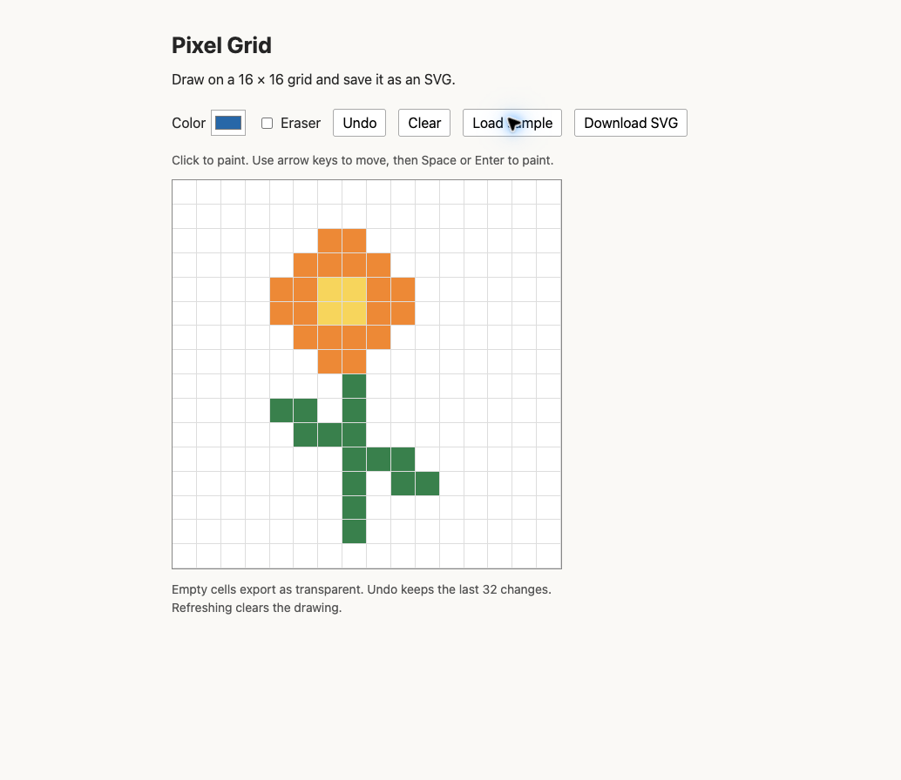

# Pixel Grid

Pixel Grid is a small React page for drawing on a 16 × 16 grid. Choose a color and click a cell, or turn on the eraser to empty it. Download SVG saves the current picture with crisp square pixels and a transparent background.

## Run it

Use Node 22.12 or newer.

```sh
npm ci
npm run dev
```

Open the local URL printed by Vite. Load sample puts a small flower on the grid so you can try editing and exporting immediately. The sample is synthetic.



Tab into the grid, move with the arrow keys, and press Space or Enter to paint. Each cell has a row, column, and color label. Undo restores the previous drawing after painting, erasing, clearing, or loading the sample. It keeps up to 32 changes. Applying an edit that changes nothing leaves the history alone.

The drawing is held in page memory and resets on refresh. There is no drag painting or file import. Empty cells appear white in the editor but remain transparent in the exported SVG.

Run `npm test` for grid, history, navigation, and SVG checks. `npm run build` creates the production files in `dist`.
